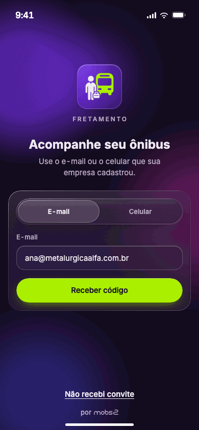
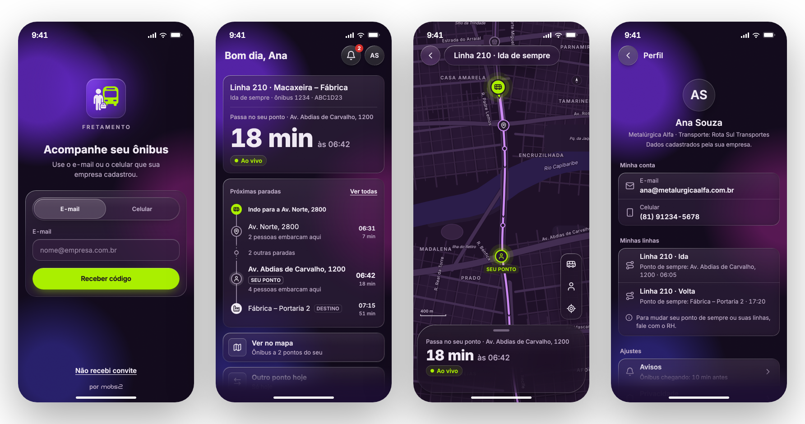
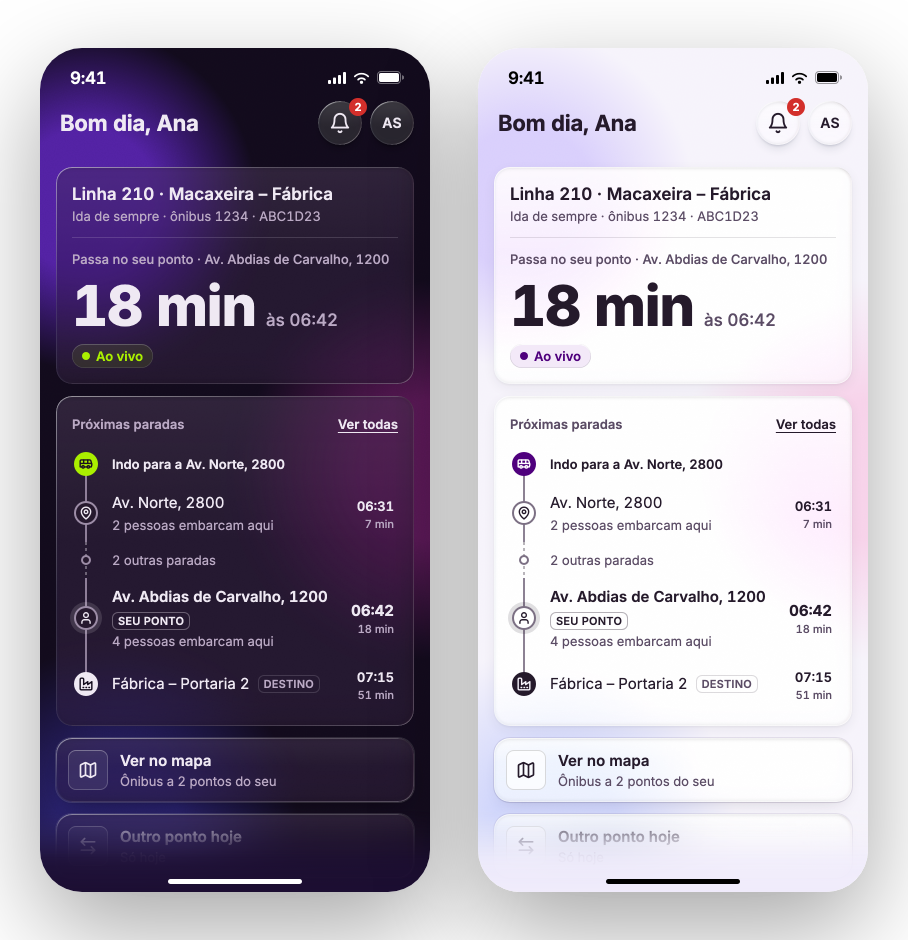
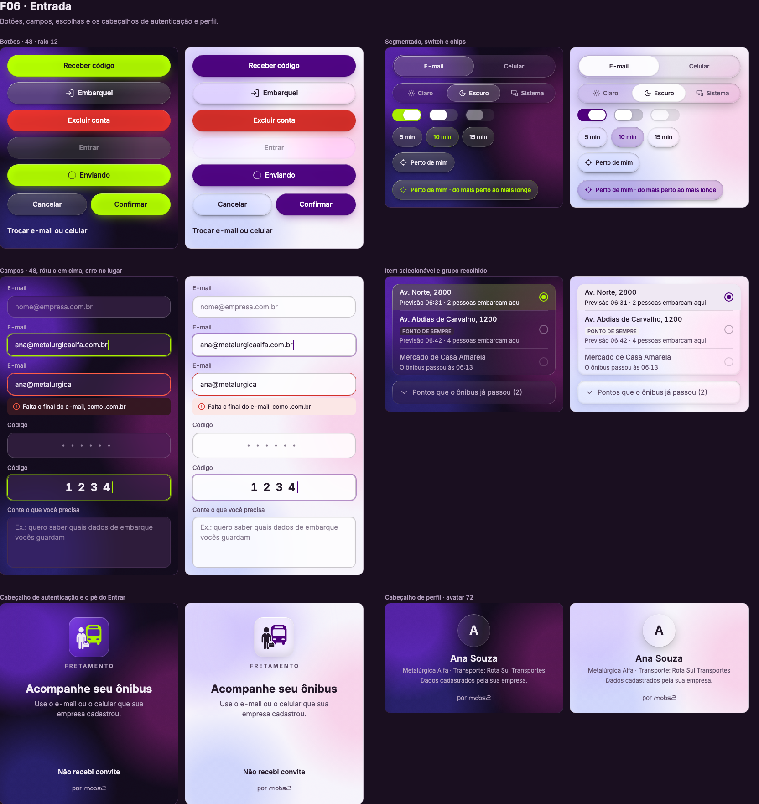

# App Passageiro Fretamento

**Design de produto e design engineering do app de quem vai de fretado para o trabalho.** Ele diz, num relance, quando o ônibus passa no seu ponto, em qual ônibus entrar e se a previsão é confiável. Do problema ao protótipo navegável em código, com o design system, as 145 referências desenhadas, o Liquid Glass e o handoff para o desenvolvimento.

> **Isto é um protótipo, não o produto.** O app daqui roda no navegador, com dados de exemplo e sem servidor, ônibus ou celular de verdade. Ele é a especificação viva do produto: o comportamento, os textos e o desenho de cada tela.
>
> **Repositório da MOBS2.** O produto, o design e o código são da empresa. Veja [Equipe e uso](#equipe-e-uso).

<p align="center">
  
</p>

<p align="center"><b><a href="https://fretamento-mobs2-prototipo.vercel.app">Abrir o protótipo →</a></b></p>

## Em números

| telas | referências desenhadas | tokens | ícones | histórias | decisões registradas | conferências |
|---|---|---|---|---|---|---|
| 13 | 145 | 77 | 64 | 15 | 15 | 18 |

As 145 referências são 13 telas, 59 momentos e 73 estados. Os 77 tokens são 47 cores (nos dois temas), 9 estilos de texto, 9 espaços, 5 raios, 5 medidas e 2 sombras. O design system tem 12 folhas desenhadas e 9 folhas de vidro tiradas do protótipo, e o vidro tem 17 peças. Os dados de exemplo trazem 145 casos, um por referência.

## O problema

O fretado tem linha, ponto e horário fixos, mas o ônibus de verdade não segue o papel: atrasa, adianta, troca de veículo, sai do trajeto ou é cancelado. Quem está no ponto fica com três perguntas sem resposta:

1. **Quando o ônibus passa no meu ponto?**
2. **Qual é o ônibus?**
3. **Dá para confiar nesse número?**

## A resposta

**Uma tela central, o Início, responde as três perguntas com um número grande e diz de onde esse número vem.** Todo o resto fica a um toque: as paradas da viagem, o mapa, o embarque em outro ponto, os avisos e o perfil. Quando algo dá errado, o app diz o que aconteceu, o que fazer e quem resolve: o RH ou a transportadora.

<p align="center">
  
</p>
<p align="center"><sub>O Entrar com a marca no quadro de vidro · o Início · o mapa · o Perfil</sub></p>

## As escolhas de design

- **O número primeiro.** A hora relativa vem na frente ("18 min"), com o horário ao lado ("às 06:42"). ([as leis](03-design-system/leis.md))
- **O lima é vivo.** Ele só aparece quando algo está vivo, e num botão principal por tela. No claro, o papel é do roxo.
- **Um agora só.** Todo tempo relativo sai do mesmo agora do estado, calculado, nunca digitado. ([decisão 011](07-decisoes/011-o-relogio-e-o-acento.md))
- **Antes do login, nada da pessoa.** Nenhum dado de quem é a pessoa aparece antes de entrar. ([decisão 003](07-decisoes/003-antes-do-login-nada-da-pessoa.md))
- **Vidro de verdade, por nível.** O Liquid Glass é o da biblioteca GlassyUI, em três níveis, sem vidro dentro de vidro. ([decisão 009](07-decisoes/009-o-vidro-e-o-da-biblioteca.md), [decisão 014](07-decisoes/014-vidro-por-nivel-e-a-entrada.md))
- **Dois temas, um desenho.** O claro nasce dos mesmos tokens: só as cores e as sombras trocam.

<p align="center">
  
</p>

As decisões, cada uma com o contexto e a consequência, estão em [`07-decisoes/`](07-decisoes/README.md).

## Do desenho ao código

O protótipo não imita o design: ele é o design rodando.

- **O design system em código.** Os tokens são CSS, gerados do `tokens.json`, e as peças são componentes React, cada uma construída uma vez. As peças de vidro são os componentes da GlassyUI, copiados para o repositório.
- **A fidelidade medida.** Cada uma das 145 referências é fotografada em 390 × 844 e comparada com o PNG desenhado. O que mudou por decisão está listado, com o porquê de cada uma.
- **O contraste medido.** Todo texto de toda tela é medido contra o fundo que ele tem, nos dois temas: 4,5:1 no texto, 3:1 no texto grande.
- **O que se toca.** Um roteiro percorre o protótipo tocando, do zero, nos dois temas, e cada saída tem de levar a algo que existe.
- **Mesma entrada, mesma saída.** O relógio é fixo (terça, 27/10/2026, 06:24), e nada é aleatório.
- **Tudo tem volta.** `?vidro=0` deixa o app sólido, igual às referências; cada peça de vidro tem a sua chave.

<p align="center">
  
</p>
<p align="center"><sub>Uma das folhas do design system tiradas do protótipo: as peças de entrada, de vidro, nos dois temas</sub></p>

**As tecnologias:** **React 19**, **Vite**, **TypeScript** e **Tailwind CSS 4**, a biblioteca de vidro **GlassyUI** com **Radix**, a fonte **Inter**, as fotos e as conferências com **Playwright** e **pixelmatch**.

## O método com IA

O protótipo foi construído por um agente de IA (Claude Code) sob a direção do designer, a partir de um design já fechado. O agente constrói o que está descrito, sem redesenhar: mede antes de afirmar, e todo desvio ganha nome no `CHANGELOG.md`. As regras que governam o agente estão no [`CLAUDE.md`](CLAUDE.md), e o método, no [`PROCESSO.md`](PROCESSO.md).

## O protótipo

O protótipo roda no navegador e anda só por toque, do Entrar ao fim do dia. No computador, o celular aparece dentro de um palco:

- o botão do canto abre o painel com as 13 telas;
- a coluna de estados oferece os exemplos parados (atrasos, falhas, sem internet, viagem cancelada), montados pelos dados de exemplo;
- o dia anda sozinho ou passo a passo: em rota, chegando, no ponto, o embarque e a chegada;
- cada referência tem um link próprio (`?ref=T05-12`), e os endereços combinam (`?ref=T07-00&tema=claro&vidro=0`).

No celular, o app ocupa a tela inteira.

## O handoff

Para quem vai construir o produto, [`08-handoff/`](08-handoff/README.md) diz qual desenho manda, a stack recomendada, o contrato com o servidor em proposta, o vidro no iOS e no Android (com a receita do Android medida no protótipo), o que o protótipo simula e como conferir cada tela contra o desenho. Cada tela tem a ficha, a tabela de estados, os textos exatos e o movimento em [`02-telas/`](02-telas/README.md).

## O repositório

```
01-produto/          por que existe, pra quem, as histórias, os fluxos e as regras de negócio
02-telas/            uma pasta por tela: ficha, estados, textos, movimento e as referências
03-design-system/    tokens (os dois temas), leis, peças, movimento, ícones, as folhas e o vidro
04-dados/            o contrato do dado, o mock, os casos e a conferência
05-recursos/         a fonte, a marca, os ícones e as imagens deste README
06-prototipo/        o protótipo navegável, o palco, as conferências e as fotos
07-decisoes/         o porquê de cada escolha
08-handoff/          qual desenho manda, a stack, o contrato com o servidor, o vidro por plataforma e como conferir
```

A ordem de leitura de cada perfil está no [`GUIA-DE-LEITURA.md`](GUIA-DE-LEITURA.md). As versões, com as datas, estão no [`CHANGELOG.md`](CHANGELOG.md).

## Rodar localmente

```bash
cd 06-prototipo/app
npm install
npm run dev
```

Abre em `http://localhost:5173`. Na mesma pasta, `npm run conferir` roda as 18 conferências, e `npm run build` gera o build. Como publicar está em [`06-prototipo/publicar.md`](06-prototipo/publicar.md).

## Equipe e uso

**Equipe da MOBS2:**
- design de produto, design system e protótipo: Luiz Felipe Silva Correia, designer de produto;
- requisitos e regras de negócio: Thacyo Lima, gerente de produtos;
- validação do protótipo e priorização do backlog para o desenvolvimento: Bruno Santana.

**Uso:** o produto, o design e o código são da **MOBS2 COMERCIO E SERVICOS LTDA - EPP**, e este repositório é da empresa. O conteúdo é para consulta: usar em outro produto, copiar ou distribuir depende de autorização da empresa. Os termos estão no [`LICENSE`](LICENSE).

**O que é de terceiros** segue a licença de cada um:
- a fonte **Inter**, sob a SIL Open Font License 1.1;
- os desenhos dos ícones, da família **Lucide**, sob a licença ISC;
- os componentes de vidro da **GlassyUI**, sob a licença MIT;
- a marca do **WhatsApp**, usada como ícone de contato, é da Meta.
